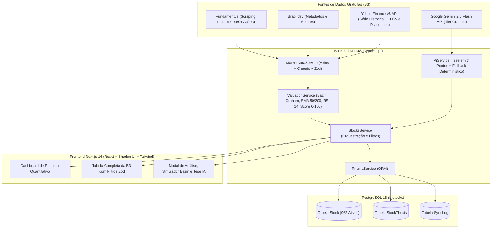

# Arquitetura do Sistema B-Stocks

## 1. Visão Geral

O **B-Stocks** foi projetado com separação estrita entre coleta/normalização de dados da B3, motor matemático determinístico, síntese assistida por IA sob demanda e apresentação visual sólida.

---

## 2. Módulos do Backend (`/backend/src`)

| Módulo | Arquivos Principais | Responsabilidade |
| :--- | :--- | :--- |
| `PrismaModule` | `prisma.service.ts`, `prisma.module.ts` | Gerencia o pool de conexões com o PostgreSQL (`b-stocks`). |
| `ValuationModule` | `valuation.service.ts` | Motor matemático determinístico puro sem efeitos colaterais. |
| `MarketDataModule` | `market-data.service.ts`, `b3-catalog.ts` | Extrai todas as empresas da B3 do Fundamentus, cruza metadados com a Brapi e consulta histórico no Yahoo Finance. |
| `AiModule` | `ai.service.ts` | Gera resumos narrativos em 3 pontos (Pontos Fortes, Riscos e Veredito) validados por Zod via Gemini API ou motor determinístico. |
| `StocksModule` | `stocks.controller.ts`, `stocks.service.ts` | Expõe os endpoints REST e gerencia paginação, filtros de corte, busca textual e sincronização. |

---

## 3. Princípios de Design e Segurança

1. **Validação Estrita com Zod:** Tanto os dados brutos extraídos das fontes externas (`RawMarketStockSchema`) quanto os parâmetros de busca (`StockFilterQuerySchema`) e o retorno estruturado da IA (`AiThesisResponseSchema`) passam por schemas Zod.
2. **Proteção de Credenciais:** Arquivos `.env` são bloqueados pelo `.gitignore` desde o primeiro commit. Nenhuma senha ou chave de API é armazenada no repositório.
3. **Interface Sólida e Neutra:** O frontend utiliza exclusivamente cores neutras sólidas (`zinc-50` a `zinc-900`), bordas de `1px` e tipografia tabular (`tabular-nums`), sem uso de gradientes ou sombras decorativas.

