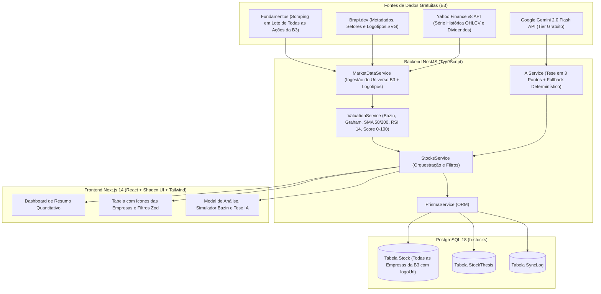

# Arquitetura do Sistema B-Stocks

## 1. Visão Geral

O **B-Stocks** foi projetado com separação estrita entre coleta/normalização de dados da B3, motor matemático determinístico, síntese assistida por IA sob demanda e apresentação visual sólida com logotipos das empresas.

---

## 2. Universo de Cobertura e Setorização

O sistema cobre 100% das empresas e ações listadas na B3 (~960+ tickers ativos), categorizando-as em seus respectivos setores e subsetores:
- **Financeiro & Bancos** (ex: `BBAS3`, `ITUB4`, `BBDC4`, `SANB11`, `ITSA4`)
- **Seguros & Previdência** (ex: `BBSE3`, `CXSE3`, `PSSA3`)
- **Utilidade Pública: Energia Elétrica** (ex: `TAEE11`, `TRPL4`, `EGIE3`, `CPFE3`, `CMIG4`)
- **Utilidade Pública: Água e Saneamento** (ex: `SBSP3`, `SAPR11`, `CSMG3`)
- **Petróleo, Gás e Biocombustíveis** (ex: `PETR4`, `PRIO3`, `UGPA3`)
- **Materiais Básicos: Mineração, Siderurgia, Papel & Celulose** (ex: `VALE3`, `GGBR4`, `SUZB3`, `KLBN11`)
- **Comunicações & Telecomunicações** (ex: `VIVT3`, `TIMS3`)
- **Bens Industriais, Construção, Consumo, Saúde e Tecnologia** (ex: `WEGE3`, `RENT3`, `ABEV3`, `RADL3`, `TOTS3`, `CURY3`, `DIRR3`)

---

## 3. Pipeline de Identificação Visual (Logotipos)

- Cada ativo armazena um campo `logoUrl` persistido no banco de dados.
- O componente `CompanyLogo` busca o SVG vetorial oficial do ativo (`https://icons.brapi.dev/icons/${ticker}.svg`).
- Caso a imagem não esteja disponível ou ocorra falha de rede, um avatar monograma sólido com as iniciais do ticker é renderizado imediatamente em estilo neutro (`zinc-100`/`zinc-800`), sem layout shift.
